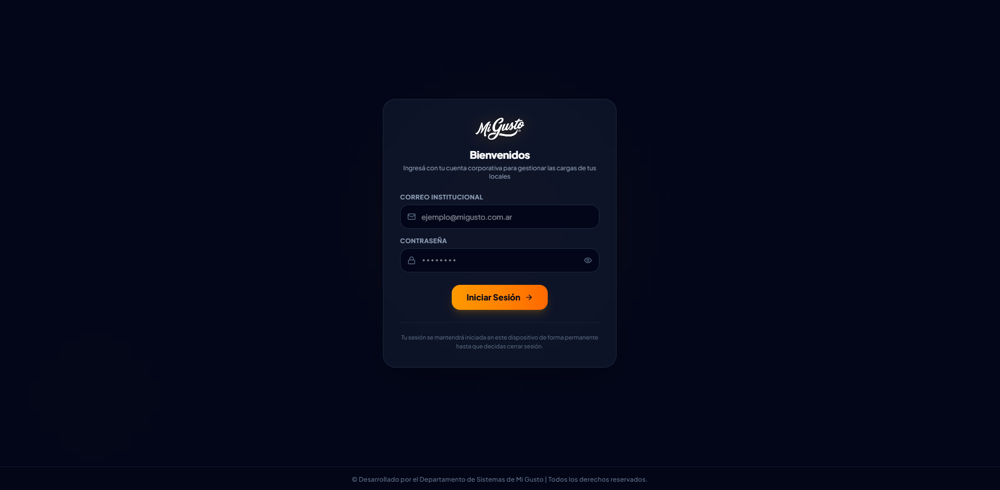
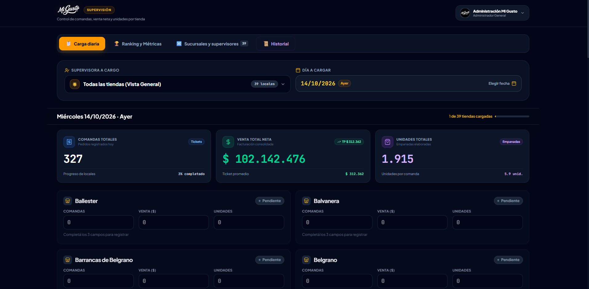
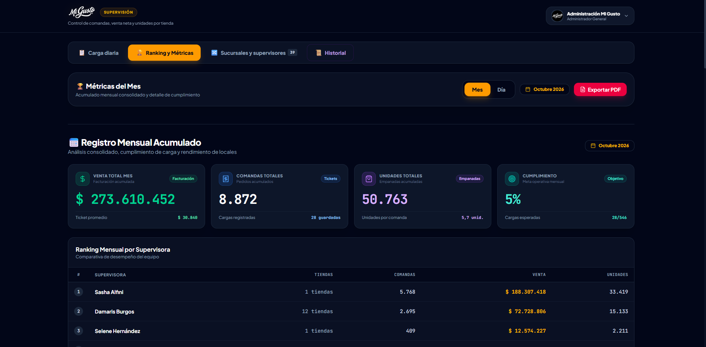
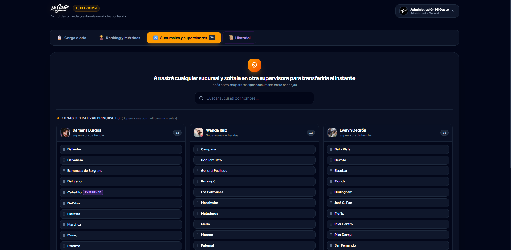
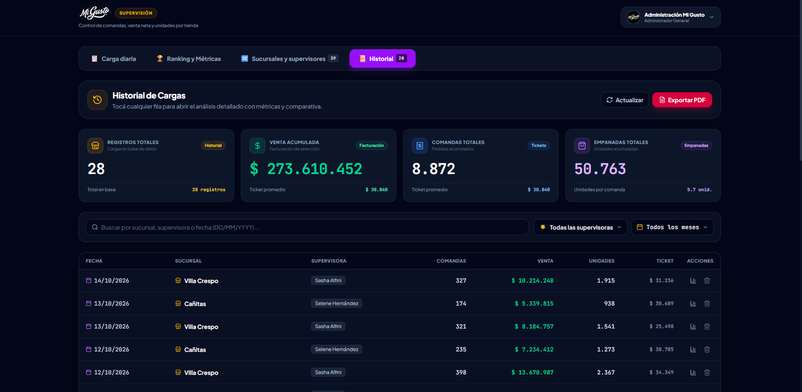
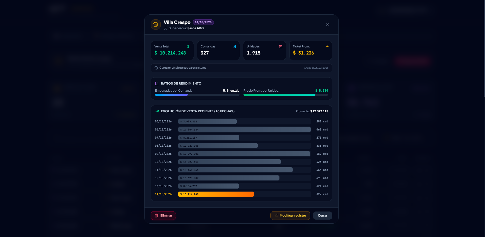

  

  # Mi Gusto · Supervisión Operativa

  **Plataforma Integral de Gestión, Auditoría y Analítica de Cargas Diarias para la Red de Sucursales**

  

    
    
    
    
    
  

---

## 🌟 Visión General

**Mi Gusto · Supervisión Operativa** es una solución corporativa de alto impacto diseñada para la administración y supervisión de más de 39 sucursales de la cadena. Centraliza la carga diaria de métricas comerciales (comandas, facturación neta y unidades elaboradas), permitiendo auditar en tiempo real el rendimiento operativo, automatizar cálculos de ticket promedio y ratios de productividad, y gestionar de manera ágil y visual la asignación de sucursales a través de tableros interactivos.

---

## 🚀 Módulos y Funcionalidades Principales

- **⚡ Carga Diaria Inteligente**:
  - Registro ágil de comandas, venta neta y unidades por sucursal.
  - Validación reactiva, detección de cambios y cálculo instantáneo de KPIs consolidados.
  - Estados dinámicos por local (*Pendiente*, *Sin guardar*, *Cargada*) con formato monetario automático.

- **📊 Ranking y Métricas de Rendimiento**:
  - Paneles analíticos con comparativas mensuales y diarias.
  - Seguimiento de cumplimiento operativo y ticket promedio consolidado.
  - Exportación ejecutiva directa a reportes PDF listos para presentación corporativa.

- **🗂️ Reasignación Dinámica Kanban**:
  - Tablero interactivo con soporte *drag & drop* para transferir sucursales entre supervisoras en tiempo real.
  - Diferenciación visual de tiendas propias, franquicias y locales *Experience*.
  - Perfiles de supervisión con avatares fotográficos integrados.

- **📜 Historial, Auditoría y Analítica Contextual**:
  - Registro cronológico integral de todas las cargas operativas de la red.
  - Filtros multicriterio por período mensual, supervisora y búsqueda inteligente.
  - Modales de análisis profundo con cálculo de ratios de rendimiento, barras evolutivas comparativas e incremento animado de métricas numéricas.

- **✨ Experiencia de Usuario Premium**:
  - Animaciones micro-interactivas fluidas potenciadas por GSAP.
  - Notificaciones toast dinámicas y efectos de celebración al consolidar cargas.
  - Interfaz oscura (*dark-mode*) de alta gama orientada a la eficiencia y comodidad visual.

---

## 📸 Galería del Sistema

### Línea 1 · Acceso Corporativo & Panel de Carga Diaria
| Autenticación Segura | Carga Diaria & KPIs Operativos |
| :---: | :---: |
|  |  |

### Línea 2 · Métricas de Rendimiento & Tablero Kanban
| Ranking & Métricas Mensuales | Tablero Kanban de Supervisión |
| :---: | :---: |
|  |  |

### Línea 3 · Historial de Cargas & Análisis Detallado
| Historial Integral con Filtros | Detalle Analítico & Evolución |
| :---: | :---: |
|  |  |

---

## 🛠️ Tecnologías Empleadas

- **Frontend Core**: [React](https://react.dev/) + [Vite](https://vitejs.dev/) para máximo rendimiento en tiempo de compilación y recarga en caliente.
- **Estilos & Diseño**: [Tailwind CSS](https://tailwindcss.com/) con paleta oscura corporativa y micro-componentes desacoplados.
- **Animaciones**: [GSAP (GreenSock)](https://gsap.com/) para transiciones orquestadas en tarjetas, números, desplegables y modales.
- **Persistencia & Backend**: [Supabase](https://supabase.com/) (PostgreSQL en la nube) con capa de persistencia resiliente en almacenamiento local.
- **Reportes & Exportación**: [html2canvas](https://html2canvas.hertzen.com/) y [jsPDF](https://github.com/parallax/jsPDF) para generación de documentos ejecutivos de alta fidelidad.
- **Iconografía**: [Lucide React](https://lucide.dev/).

---

  Desarrollado con dedicación para el equipo operativo de Mi Gusto. Todos los derechos reservados.

